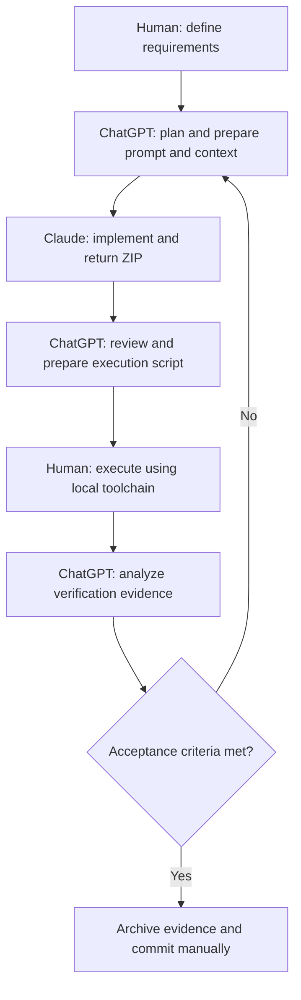

# Human-in-the-Loop Multi-LLM Development Workflow

The methodology is a human-orchestrated, multi-LLM engineering workflow with independent implementation, review and execution responsibilities. It enables agentic-style development without requiring either LLM to have direct access to the local development environment.

## 1. Role separation

| Participant | Role | Responsibilities |
|---|---|---|
| Human engineer | Orchestrator | Requirements, approvals, artifact transfer, local execution and Git operations |
| ChatGPT | Planner and reviewer | Architecture, specifications, implementation prompts, independent review, integration scripts and results analysis |
| Claude | Implementation agent | Source code, testbenches, documentation and implementation decisions |
| Local toolchain | Verification authority | Compilation, simulation, synthesis and objective engineering evidence |
| Senior engineer | Domain expert | Professional assessment and final engineering review |

## 2. Development cycle



## 3. Detailed workflow

| Stage | Input | Action | Output |
|---|---|---|---|
| 1. Planning | Human requirements | ChatGPT establishes scope and acceptance criteria | Specification |
| 2. Context preparation | Repository files and specification | ChatGPT prepares a self-contained handoff | `context.zip`, `prompt.md` |
| 3. Implementation | Context and prompt | Claude implements the assignment | `implementation.zip` |
| 4. Independent review | Implementation archive | ChatGPT reviews implementation and identifies defects | Review findings |
| 5. Integration | Reviewed implementation | ChatGPT generates a standalone execution script | `install_and_verify.sh` |
| 6. Execution | ZIP and script | Human executes the script locally | Terminal output and verification artifacts |
| 7. Analysis | Verification artifacts | ChatGPT evaluates objective results | Findings and corrections |
| 8. Closure | Accepted results | Archive evidence and document decisions | Version-controlled milestone |

## 4. Artifact exchange protocol

Since neither LLM has direct access to the local repository, communication takes place through explicit, portable artifacts.

```text
ChatGPT -> Human -> Claude
    context.zip
    prompt.md

Claude -> Human -> ChatGPT
    implementation.zip

ChatGPT -> Human -> Local Environment
    install_and_verify.sh

Local Environment -> Human -> ChatGPT
    terminal_output
    verification_results.zip

ChatGPT -> Human
    RESULTS.md
    correction.sh (if necessary)
    archive.sh (upon acceptance)
```

When ChatGPT requires the current state of the local repository, it provides a standalone collector script that packages only the relevant files into a context archive. This avoids repeatedly uploading the entire repository and reduces LLM context consumption.

## 5. Standalone script contract

Every script delivered to the human engineer should follow a consistent operational contract.

| Requirement | Behavior |
|---|---|
| Execution location | Repository root |
| Prerequisites | Explicitly checked before execution |
| Dependencies | Reuse the established toolchain |
| File installation | Validate archive contents and destination paths |
| Protected files | Verify integrity before and after execution |
| Filesystem scope | Write only within the repository |
| Verification | Automatically execute applicable engineering tools |
| Error handling | Report meaningful failures |
| Evidence | Preserve logs and generated results |
| Dependency installation | Never automatic |
| Git operations | Never automatically commit or push |
| Privileges | No privilege escalation |

The human engineer should generally need to execute only one command:

```bash
bash install_and_verify.sh
```

All installation, environment configuration, verification and evidence collection should be encapsulated by the script.

## 6. Engineering principles

- **Separation of implementation and review:** one LLM generates the implementation; another independently reviews it.
- **Objective verification:** LLM statements are not accepted as evidence of successful compilation, testing or synthesis.
- **Reproducibility:** development and verification procedures are captured in executable scripts.
- **Traceability:** architectural decisions, defects, corrections and results are documented.
- **Human control:** the engineer retains authority over local execution, repository modifications and milestone acceptance.
- **Minimal human overhead:** the engineer transfers artifacts and executes scripts rather than manually assembling generated code.
- **Iterative refinement:** failed verification produces a targeted correction cycle rather than restarting the entire implementation.

## 7. Comparison with fully agentic development

| Capability | Our workflow | Fully agentic environment |
|---|---|---|
| Repository access | Artifact-based | Direct |
| Context collection | Collector scripts | Autonomous |
| Code generation | Claude | Implementation agent |
| Independent review | ChatGPT | Reviewer agent |
| Command execution | Human launches scripts | Autonomous |
| Results collection | Human transfers artifacts | Automatic |
| Approval | Human | Configurable |
| Git operations | Human-controlled | Potentially autonomous |
| Verification | Local engineering tools | Local engineering tools |

Our methodology effectively emulates a multi-agent software engineering environment through explicit artifact exchange, with the human acting as the orchestration and execution layer.

## 8. Research terminology

Proposed methodology name: **Human-Orchestrated Multi-Agent Engineering (HOMAE)**.

> A human-in-the-loop engineering methodology in which multiple large language models assume distinct planning, implementation and review responsibilities. Collaboration is conducted through structured, portable artifacts, while reproducible execution scripts connect the language models to an isolated local engineering environment. Objective tool-generated evidence determines milestone acceptance, and the human engineer retains control over execution, repository state and final engineering decisions.

This describes the workflow independently of the particular engineering component being developed.

## 9. Limitations

Using two different LLMs provides implementation-review separation, but does not guarantee independent reasoning or correctness. External engineering tools and independent reference models remain the primary sources of verification evidence. The workflow describes the intended operational contract; individual milestones are only accepted when their actual verification evidence supports acceptance.
